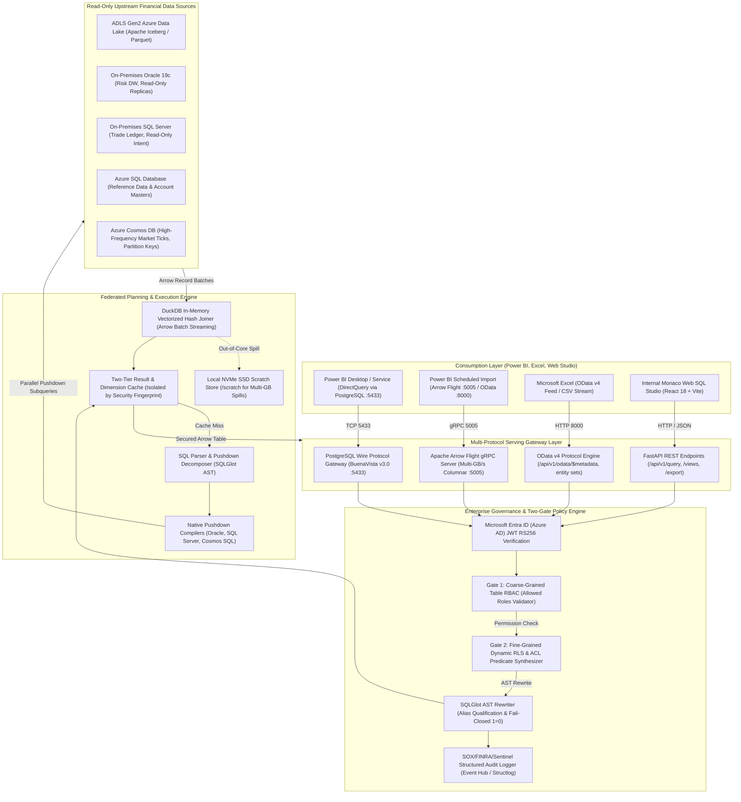
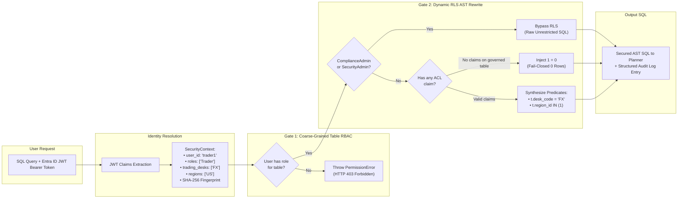
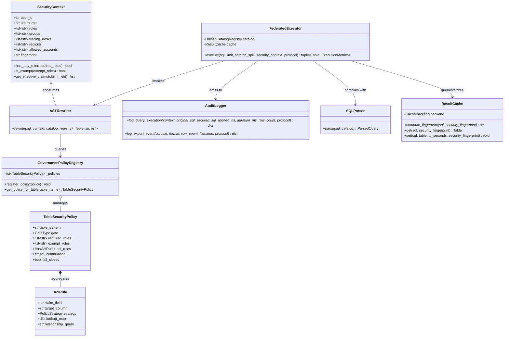
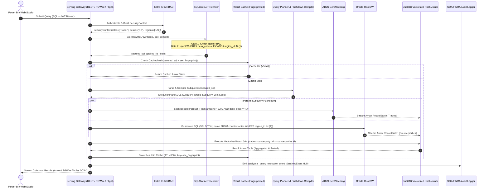
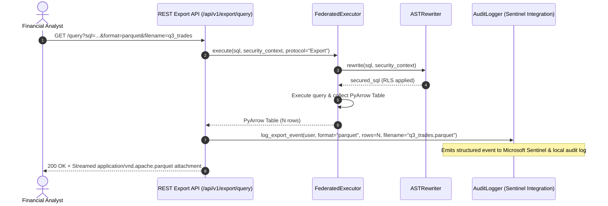
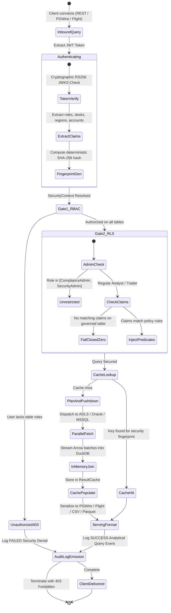

# Enterprise Federated Semantic Data Hub & Governance Architecture

This document provides complete, presentation-grade architecture blueprints, UML diagrams, sequence flows, and infographic summaries for the **Federated Financial Data Hub & Dynamic Governance Layer**.

---

## 1. High-Level System Architecture

The platform acts as a zero-ETL federated semantic query layer connecting **10 TB – 100 TB of heterogeneous, read-only financial data** across cloud and on-premises systems directly into Power BI, Excel, and analytical clients without commercial virtualization licensing fees.

---

## 2. Two-Gate Security & Dynamic RLS Architecture

---

## 3. UML Class Diagram: Governance, Federation & Serving

---

## 4. Sequence Diagram: End-to-End Secured Analytical Query Execution

---

## 5. Sequence Diagram: Data Export Lifecycle with Compliance Audit

---

## 6. State Diagram: Query Security Lifecycle

---

## 7. Architectural Comparison: In-House Engine vs. Commercial Alternatives

| Dimension | In-House Hub (Built Solution) | Denodo / Dremio | Direct Power BI Import (ETL) |
|---|---|---|---|
| **Licensing Cost** | **\$0 (100% Open Source: DuckDB, PyArrow, FastAPI, SQLGlot)** | \$150k – \$500k+ / year recurring core licensing | Power BI Premium / Fabric capacity costs |
| **Catalog Modification** | **Zero Modification** (Read-Only metadata & data lake inspection) | Requires catalog registration & view publishing | Requires heavy scheduled ingestion pipelines |
| **Row-Level Security** | **Dynamic AST Rewrite** (Two-gate coarse RBAC + fine ACL injection) | Custom proprietary VQL security wrappers | Static Power BI DAX RLS (brittle at 100 TB scale) |
| **Memory Architecture** | **In-Memory Arrow Streaming** + NVMe SSD local spill joins | Heavy JVM server clusters (GBs of overhead) | In-memory VertiPaq limited by RAM capacity |
| **Serving Interfaces** | **PGWire (:5433), Arrow Flight (:5005), OData, REST, Monaco Studio** | Proprietary JDBC/ODBC drivers required | Standard Power BI Desktop only |
| **Regulatory Audit** | **SOX/FINRA native JSON** direct to Microsoft Sentinel & Event Hub | Clunky local syslog / database audit logs | Activity logs with limited query visibility |
